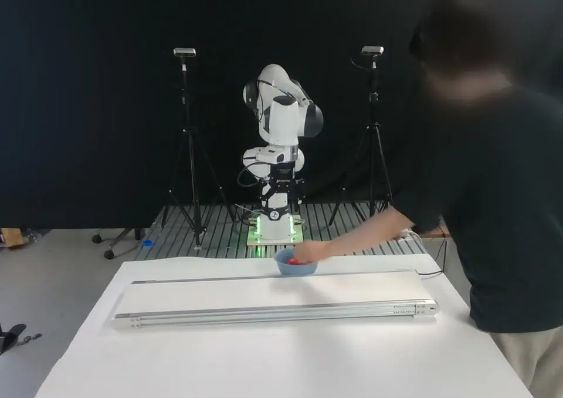
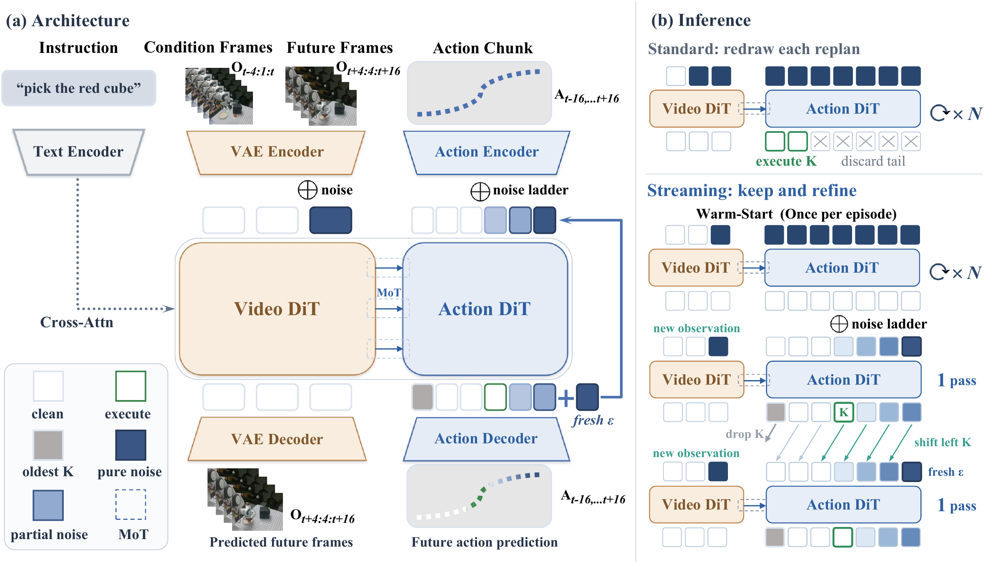

<h1 align="center">StreamingWAM: Streaming World Action Modeling via Chunk-Wise Staircase Flow Matching</h1>

<p align="center">
  <a href="https://openreview.net/profile?id=~shaojie_ren1">Shaojie Ren</a><sup>1,2,3,*</sup>,
  <a href="https://openreview.net/profile?id=~Jingwen_Sun2">Jingwen Sun</a><sup>4,*</sup>,
  <a href="https://openreview.net/profile?id=~Zezhi_Liu1">Zezhi Liu</a><sup>5</sup>,
  <a href="https://openreview.net/profile?id=~Hongjin_Chen2">Hongjin Chen</a><sup>6</sup>,
  <a href="https://openreview.net/profile?id=~Xin_Jin8">Xin Jin</a><sup>7</sup>,
  <a href="https://openreview.net/profile?id=~Wei_Zou2">Wei Zou</a><sup>3,†</sup>,
  <a href="https://openreview.net/profile?id=~Zhibo_Chen1">Zhibo Chen</a><sup>4,†</sup>
</p>

<p align="center">
  <sup>1</sup> University of Chinese Academy of Sciences &nbsp;&nbsp;
  <sup>2</sup> Beijing Zhongguancun Academy &nbsp;&nbsp;
  <sup>3</sup> Institute of Automation, Chinese Academy of Sciences<br>
  <sup>4</sup> University of Science and Technology of China &nbsp;&nbsp;
  <sup>5</sup> Nankai University &nbsp;&nbsp;
  <sup>6</sup> Harbin Institute of Technology &nbsp;&nbsp;
  <sup>7</sup> Eastern Institute of Technology, Ningbo
</p>

<p align="center">
  <sup>*</sup> Equal contribution. &nbsp;&nbsp;
  <sup>†</sup> Corresponding authors.
</p>

<p align="center">
  <a href="https://renshaojie233.github.io/StreamingWAM/"></a>
  <a href="https://arxiv.org/abs/2610.15585"></a>
  <a href="https://huggingface.co/rsj2003/StreamingWAM-LIBERO"></a>
  <a href="https://huggingface.co/rsj2003/StreamingWAM-RealWorld"></a>
  <a href="https://huggingface.co/datasets/rsj2003/StreamingWAM-RealWorld"></a>
</p>

<p align="center">
  <a href="https://github.com/renshaojie233/StreamingWAM/releases/download/supplementary-v1/03-additional-trial__camera-04.mp4">
    
  </a>
</p>

<p align="center"><em>Real-robot demonstration (50 s, original 1× speed, 15 fps preview; starts automatically).</em> · <a href="https://github.com/renshaojie233/StreamingWAM/releases/download/supplementary-v1/03-additional-trial__camera-04.mp4">Open the original MP4</a></p>

Official implementation of [StreamingWAM (Ren et al., arXiv:2610.15585)](https://arxiv.org/abs/2610.15585).
See the [StreamingWAM project page](https://renshaojie233.github.io/StreamingWAM/)
for robot demonstrations, comparisons, and results.

**StreamingWAM** is a streaming world-action model for responsive closed-loop
robot control. It maintains a persistent action buffer and continuously refines
future actions as new observations arrive, using chunk-wise staircase flow
matching to preserve temporal continuity while reducing observation delay.



*StreamingWAM architecture and inference. A persistent action buffer is shifted
and refined once whenever a new observation arrives.*

StreamingWAM keeps a rolling action buffer and updates it with a token-wise
staircase noise schedule. The released configuration uses a 16-step clean
action prefix, a 16-step predicted suffix, one Euler update per replanning call,
and a 10-step sampler only for the episode-initial warm start.

The code is based on the MIT-licensed
[FastWAM repository](https://github.com/yuantianyuan01/FastWAM). See
[NOTICE](NOTICE) for attribution and [REPRODUCIBILITY.md](docs/REPRODUCIBILITY.md)
for the released protocol.

## Evaluation update — 2026-10-17

We corrected LIBERO-Plus instruction handling to remove trailing benchmark
metadata while preserving language perturbations. With the reference
checkpoint, the full 10,030-task result is **82.12% (8,237 successes)**, compared
with the historical **79.36% (7,960 successes)** under raw instructions.
Both `clean` and `legacy` evaluation modes are available; training is unchanged.
See the [results, checkpoint identities, and versioned instructions](docs/evaluation/README.md).
The Hugging Face download is now aligned with the verified reference
checkpoint used for both results.

## Release scope

This release contains the LIBERO-Plus training and evaluation pipeline plus a
clean model-side real-robot reference implementation.

- StreamingWAM training on the four LIBERO suites used by LIBERO-Plus.
- Rolling evaluation over an arbitrary task manifest.
- The 10,030-episode LIBERO-Plus manifest and normalization statistics used in
  the reported run.
- Exact paper hyperparameters and a machine-checkable release manifest.
- Plain 15 Hz StreamingWAM real-robot rolling inference with no latency-shift
  checkpoint, lead-tick submission, plan blending, or trajectory smoothing.

The released LIBERO-trained checkpoint is hosted in the public
[StreamingWAM-LIBERO model repository](https://huggingface.co/rsj2003/StreamingWAM-LIBERO).
The recommended launcher trains the shared FastWAM-Joint initialization and
transfers its weights into the selected stage-two branch automatically.

The real-world demonstrations are hosted separately in the public
[StreamingWAM-RealWorld dataset repository](https://huggingface.co/datasets/rsj2003/StreamingWAM-RealWorld).
The exact formal 7-task/15 Hz conversion and validation scripts are included
in [`data_processing/realworld_7task_15hz/`](data_processing/realworld_7task_15hz/).
The public dataset is a 590-trajectory publication subset; the conversion
README records the distinction from the complete 1,083-episode training source.
It contains 590 trajectories across seven tasks. The apple-to-bowl task has
50 static and 50 dynamic trajectories, grouped as two conditions of the same
task.

The final real-world StreamingWAM checkpoint, normalization statistics, and
cached prompt embeddings are hosted in the public
[StreamingWAM-RealWorld model repository](https://huggingface.co/rsj2003/StreamingWAM-RealWorld).
See [real_robot/README.md](real_robot/README.md) for the exact observation,
action, and rolling-execution contracts.

## Installation

The reported environment used Python 3.10, PyTorch 2.7.1, CUDA 12.8, and
MuJoCo 3.3.2.

```bash
conda create -n streamingwam python=3.10 -y
conda activate streamingwam
pip install -U pip
pip install torch==2.7.1+cu128 torchvision==0.22.1+cu128 \
  --extra-index-url https://download.pytorch.org/whl/cu128
pip install -e .
pip install mujoco==3.3.2
```

Install [LIBERO](https://github.com/Lifelong-Robot-Learning/LIBERO) and the
LIBERO-Plus task definitions in the same environment. The preprocessed LIBERO
data expected by the default configuration follow the layout published with
[FastWAM](https://huggingface.co/datasets/yuanty/LIBERO-fastwam):

```text
data/libero_mujoco3.3.2/
├── libero_10_no_noops_lerobot/
├── libero_goal_no_noops_lerobot/
├── libero_object_no_noops_lerobot/
└── libero_spatial_no_noops_lerobot/
```

Set the Wan model cache and create the ActionDiT initialization before
training:

```bash
export DIFFSYNTH_MODEL_BASE_PATH="$PWD/checkpoints"
python scripts/preprocess_action_dit_backbone.py \
  --model-config configs/model/fastwam.yaml \
  --output checkpoints/ActionDiT_linear_interp_Wan22_alphascale_1024hdim.pt \
  --device cuda --dtype bfloat16
```

## Training

Precompute the instruction embeddings, then launch the complete two-stage
training protocol with one command:

```bash
python scripts/precompute_text_embeds.py task=streamingwam_libero_plus

python scripts/train_libero_plus_two_stage.py --nproc-per-node 4
```

The launcher first trains the ordinary shared-timestep FastWAM-Joint model for
34,720 optimization steps. It then transfers the resulting model weights to
the StreamingWAM configuration and trains the streaming objective for another
40,000 steps. The stage-two optimizer and 60,000-step cosine scheduler start
fresh, with no learning-rate warm-up. The intermediate Joint checkpoint is
retained automatically for recovery and inspection; users do not need to find
or pass it manually.

To reproduce the paper's equal-budget comparison, run both stage-two branches
from that same checkpoint:

```bash
python scripts/train_libero_plus_two_stage.py --nproc-per-node 4 --second-stage both
```

This adds a FastWAM-Joint continuation with the same 40,000 optimization steps,
global batch size of 64, and 60,000-step cosine schedule used by the
StreamingWAM branch. Use `--second-stage joint` to run only that continuation.

Use `--dry-run` to inspect both generated launch commands without starting a
job. Additional Hydra overrides may be appended after the launcher options.

To run only the second stage from an existing Joint checkpoint, use the
lower-level command below. A `.pt` path passed to `resume` loads model weights
only and starts a fresh optimizer and scheduler at step zero.

```bash
bash scripts/train_zero1.sh 4 \
  task=streamingwam_libero_plus \
  resume=/path/to/fastwam_joint_step_034720.pt
```

The released checkpoint is `streamingwam_libero.pt`, corresponding to the
reported 40,000-step checkpoint from a schedule configured for at most 60,000
steps.

## Evaluation

Download the released checkpoint and verify both its SHA-256 digest and state
dict structure:

```bash
python scripts/download_checkpoint.py
python scripts/check_checkpoint.py \
  checkpoints/streamingwam-libero/streamingwam_libero.pt
```

After installing LIBERO and LIBERO-Plus, run one rollout as an end-to-end smoke
test:

```bash
bash scripts/smoke_test_libero.sh
```

This command runs the `K=4` rolling-inference setting on the included
10,030-episode manifest, using the corrected instruction protocol. See the
[checkpoint identity note](docs/evaluation/README.md#checkpoint-identity) for
the checkpoint associated with the reported scores:

```bash
python experiments/libero/eval_libero_task_list_multi_k.py \
  task=streamingwam_libero_plus \
  ckpt=checkpoints/streamingwam-libero/streamingwam_libero.pt \
  EVALUATION.dataset_stats_path=assets/libero_dataset_stats.json \
  +EVALUATION.task_list_file=assets/libero_plus_full_10030.txt \
  +EVALUATION.sdp_k_values='[4]' \
  EVALUATION.prompt_protocol=clean \
  EVALUATION.output_dir=evaluate_results/prompt_clean \
  EVALUATION.num_trials=1 \
  EVALUATION.action_horizon=32 \
  EVALUATION.num_inference_steps=1 \
  +EVALUATION.sdp_num_noise_levels=32 \
  +EVALUATION.sdp_warm_start=true \
  +EVALUATION.sdp_warm_start_inference_steps=10 \
  +EVALUATION.save_rollout_video=false
```

To retain the original raw-instruction behavior, use
`EVALUATION.prompt_protocol=legacy` and a separate output directory such as
`EVALUATION.output_dir=evaluate_results/prompt_legacy`. The
[legacy release](https://github.com/renshaojie233/StreamingWAM/tree/liberoplus-eval-v1)
and [corrected release](https://github.com/renshaojie233/StreamingWAM/tree/liberoplus-eval-v2)
are both preserved.

For a robustness sweep, use
`+EVALUATION.sdp_k_values='[1,2,4,8,16]'`. The released training distribution
contains `K={1,2,4,8}`; `K=16` is the unseen execution horizon.

To shard the manifest across processes, add
`+EVALUATION.num_workers=N +EVALUATION.worker_index=i` and assign one GPU to
each process with `gpu_id=i`. Each process loads the checkpoint once and writes
its own summary.

## Validation

```bash
python scripts/check_release.py
python -m compileall -q src experiments scripts
```

The release check rejects private absolute paths, backup files, generated
bytecode, archives, and common credential patterns.

## License

The repository is released under the MIT License. External datasets, model
weights, and benchmark assets retain their own licenses and terms.
