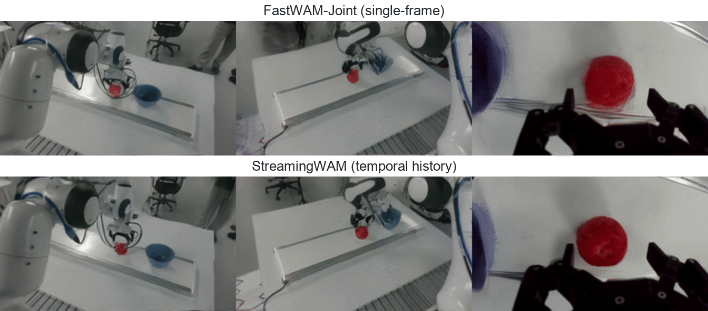

<h1 align="center">StreamingWAM: Streaming World Action Modeling via Chunk-Wise Staircase Flow Matching</h1>

<p align="center">
  <a href="https://openreview.net/profile?id=~shaojie_ren1">Shaojie Ren</a><sup>1,2,3,*</sup>,
  <a href="https://openreview.net/profile?id=~Jingwen_Sun2">Jingwen Sun</a><sup>4,*</sup>,
  <a href="https://openreview.net/profile?id=~Zezhi_Liu1">Zezhi Liu</a><sup>5</sup>,
  <a href="https://openreview.net/profile?id=~Hongjin_Chen2">Hongjin Chen</a><sup>6</sup>,
  <a href="https://openreview.net/profile?id=~Xin_Jin8">Xin Jin</a><sup>7</sup>,
  <a href="https://openreview.net/profile?id=~Wei_Zou2">Wei Zou</a><sup>3,†</sup>,
  <a href="https://openreview.net/profile?id=~Zhibo_Chen1">Zhibo Chen</a><sup>4,†</sup>
</p>

<p align="center">
  <sup>1</sup> University of Chinese Academy of Sciences &nbsp;&nbsp;
  <sup>2</sup> Beijing Zhongguancun Academy &nbsp;&nbsp;
  <sup>3</sup> Institute of Automation, Chinese Academy of Sciences<br>
  <sup>4</sup> University of Science and Technology of China &nbsp;&nbsp;
  <sup>5</sup> Nankai University &nbsp;&nbsp;
  <sup>6</sup> Harbin Institute of Technology &nbsp;&nbsp;
  <sup>7</sup> Eastern Institute of Technology, Ningbo
</p>

<p align="center">
  <sup>*</sup> Equal contribution. &nbsp;&nbsp;
  <sup>†</sup> Corresponding authors.
</p>

<p align="center">
  <a href="https://renshaojie233.github.io/StreamingWAM/"></a>
  <a href="https://arxiv.org/abs/2610.15585"></a>
  <a href="https://huggingface.co/rsj2003/StreamingWAM-LIBERO"></a>
  <a href="https://huggingface.co/rsj2003/StreamingWAM-RealWorld"></a>
  <a href="https://huggingface.co/datasets/rsj2003/StreamingWAM-RealWorld"></a>
</p>

Official implementation of **StreamingWAM**, a world-action model for responsive robot control. It keeps a rolling action buffer and refines future actions as new observations arrive, preserving continuity across updates.

### 🧭 Contents

| Explore the project | Run the code | Reference |
| :--- | :--- | :--- |
| [🎬 Demonstrations](#demonstrations) | [⚙️ Installation](#installation) | [📰 Latest update](#latest-update) |
| [🧩 Overview](#overview) | [🚀 Training](#training) | [✅ Repository checks](#repository-checks) |
| [📦 Models and data](#models-and-data) | [📊 Evaluation](#evaluation) | [📄 Acknowledgments and license](#acknowledgments-and-license) |

<a id="demonstrations"></a>

## 🎬 Demonstrations

https://github.com/user-attachments/assets/ae8c53cc-0697-497a-948e-c96a5676f848

<p align="center"><em>Real-robot demonstration with the main view on the left and the three model-input views stacked on the right (50 s, 15 fps, 1× speed).</em></p>

### Anticipating motion



In these stage-matched examples from separate trials, StreamingWAM predicts the apple moving along the conveyor, while FastWAM-Joint predicts little displacement. This qualitative comparison is consistent with temporal visual history helping the WAM anticipate target motion. [More details](https://renshaojie233.github.io/StreamingWAM/#anticipation).

<a id="overview"></a>

## 🧩 Overview


The action buffer shifts forward as the robot executes actions. A staircase noise schedule lets the model refine the remaining actions with each new observation.

The released configuration uses:

- **Context:** a 16-step clean action prefix and temporal visual history.
- **Prediction:** a 16-step future action suffix, refined with one Euler update per replanning call.
- **Initialization:** a 10-step sampler for the episode-initial warm start.

See [the released protocol](docs/REPRODUCIBILITY.md) for hyperparameters and execution details.

<a id="latest-update"></a>

## 📰 Latest update

**October 17, 2026 — LIBERO-Plus evaluation fix.** We removed trailing benchmark metadata from instructions while preserving language perturbations. Training is unchanged, and both evaluation modes remain available.

| Instruction protocol | Success rate | Successful episodes |
| --- | ---: | ---: |
| `clean` — corrected | **82.12%** | **8,237 / 10,030** |
| `legacy` — original raw instructions | 79.36% | 7,960 / 10,030 |

The Hugging Face download is aligned with the verified reference checkpoint used for both results. [Results, checkpoint identities, and versioned instructions →](docs/evaluation/README.md)

<a id="models-and-data"></a>

## 📦 Models and data

The current release includes training on the four LIBERO suites, LIBERO-Plus evaluation, and a model-side real-robot reference implementation.

| Resource | Download | Usage |
| --- | --- | --- |
| LIBERO checkpoint | [Hugging Face](https://huggingface.co/rsj2003/StreamingWAM-LIBERO) | [Evaluation](#evaluation) |
| Real-robot checkpoint, statistics, and prompt embeddings | [Hugging Face](https://huggingface.co/rsj2003/StreamingWAM-RealWorld) | [Robot inference](real_robot/README.md) |
| Real-robot demonstrations | [Hugging Face](https://huggingface.co/datasets/rsj2003/StreamingWAM-RealWorld) | [Data conversion and validation](data_processing/realworld_7task_15hz/) |

The public dataset contains **590 trajectories across seven tasks**. The apple-to-bowl task includes 50 static and 50 dynamic trajectories. This is a publication subset of the 1,083-episode training source; the [conversion README](data_processing/realworld_7task_15hz/) explains the mapping.

<details>
<summary>What else is included?</summary>

- Rolling evaluation over arbitrary task manifests, including the full 10,030-episode LIBERO-Plus manifest and normalization statistics.
- Paper hyperparameters and a machine-checkable release manifest.
- Plain 15 Hz real-robot rolling inference, with no latency-shift checkpoint, lead-tick submission, plan blending, or trajectory smoothing.

</details>

<a id="installation"></a>

## ⚙️ Installation

### 1. Create the environment

The reported environment uses Python 3.10, PyTorch 2.7.1, CUDA 12.8, and MuJoCo 3.3.2.

```bash
conda create -n streamingwam python=3.10 -y
conda activate streamingwam
pip install -U pip
pip install torch==2.7.1+cu128 torchvision==0.22.1+cu128 \
  --extra-index-url https://download.pytorch.org/whl/cu128
pip install -e .
pip install mujoco==3.3.2
```

### 2. Install the benchmarks and prepare data

Install [LIBERO](https://github.com/Lifelong-Robot-Learning/LIBERO) and the LIBERO-Plus task definitions in the same environment. For training, the default configuration expects the preprocessed data layout from [FastWAM](https://huggingface.co/datasets/yuanty/LIBERO-fastwam):

```text
data/libero_mujoco3.3.2/
├── libero_10_no_noops_lerobot/
├── libero_goal_no_noops_lerobot/
├── libero_object_no_noops_lerobot/
└── libero_spatial_no_noops_lerobot/
```

<a id="training"></a>

## 🚀 Training

### 1. Prepare the initialization

Set the Wan model cache and create the ActionDiT initialization:

```bash
export DIFFSYNTH_MODEL_BASE_PATH="$PWD/checkpoints"
python scripts/preprocess_action_dit_backbone.py \
  --model-config configs/model/fastwam.yaml \
  --output checkpoints/ActionDiT_linear_interp_Wan22_alphascale_1024hdim.pt \
  --device cuda --dtype bfloat16
```

### 2. Start two-stage training

Precompute the instruction embeddings, then run the launcher. It handles the transition between stages and retains the intermediate Joint checkpoint automatically.

```bash
python scripts/precompute_text_embeds.py task=streamingwam_libero_plus

python scripts/train_libero_plus_two_stage.py --nproc-per-node 4
```

| Stage | Training objective | Optimization steps |
| --- | --- | ---: |
| 1 | Standard shared-timestep FastWAM-Joint | 34,720 |
| 2 | StreamingWAM | 40,000 |

Stage 2 loads the Joint weights and starts a fresh optimizer and 60,000-step cosine schedule, without learning-rate warm-up. The released `streamingwam_libero.pt` is the 40,000-step checkpoint from that schedule.

<details>
<summary>Train the Joint comparison branch</summary>

To reproduce the equal-budget training setup, run both stage-two branches from the same Joint checkpoint:

```bash
python scripts/train_libero_plus_two_stage.py --nproc-per-node 4 --second-stage both
```

Both branches use 40,000 optimization steps, a global batch size of 64, and a 60,000-step cosine schedule. Use `--second-stage joint` to run only the Joint continuation.

</details>

<details>
<summary>Start from an existing Joint checkpoint or inspect the launch commands</summary>

Use `--dry-run` with the two-stage launcher to inspect the generated commands without starting a job. Additional Hydra overrides can follow the launcher options.

To run only the second stage from an existing checkpoint:

```bash
bash scripts/train_zero1.sh 4 \
  task=streamingwam_libero_plus \
  resume=/path/to/fastwam_joint_step_034720.pt
```

Passing a `.pt` path to `resume` loads model weights only. The optimizer and scheduler start fresh at step zero.

</details>

<a id="evaluation"></a>

## 📊 Evaluation

### 1. Download and verify the checkpoint

The check validates the SHA-256 digest and state dict structure.

```bash
python scripts/download_checkpoint.py
python scripts/check_checkpoint.py \
  checkpoints/streamingwam-libero/streamingwam_libero.pt
```

### 2. Test one rollout

After installing LIBERO and LIBERO-Plus, run the end-to-end smoke test:

```bash
bash scripts/smoke_test_libero.sh
```

### 3. Run the full evaluation

The following command evaluates `K=4` on the included 10,030-episode manifest with the corrected instruction protocol. See the [checkpoint identity note](docs/evaluation/README.md#checkpoint-identity) for the weights associated with the reported scores.

```bash
python experiments/libero/eval_libero_task_list_multi_k.py \
  task=streamingwam_libero_plus \
  ckpt=checkpoints/streamingwam-libero/streamingwam_libero.pt \
  EVALUATION.dataset_stats_path=assets/libero_dataset_stats.json \
  +EVALUATION.task_list_file=assets/libero_plus_full_10030.txt \
  +EVALUATION.sdp_k_values='[4]' \
  EVALUATION.prompt_protocol=clean \
  EVALUATION.output_dir=evaluate_results/prompt_clean \
  EVALUATION.num_trials=1 \
  EVALUATION.action_horizon=32 \
  EVALUATION.num_inference_steps=1 \
  +EVALUATION.sdp_num_noise_levels=32 \
  +EVALUATION.sdp_warm_start=true \
  +EVALUATION.sdp_warm_start_inference_steps=10 \
  +EVALUATION.save_rollout_video=false
```

<details>
<summary>Legacy instructions, execution-horizon sweeps, and parallel evaluation</summary>

**Legacy instructions.** Set `EVALUATION.prompt_protocol=legacy` and use a separate output directory, such as `EVALUATION.output_dir=evaluate_results/prompt_legacy`. Both the [legacy release](https://github.com/renshaojie233/StreamingWAM/tree/liberoplus-eval-v1) and the [corrected release](https://github.com/renshaojie233/StreamingWAM/tree/liberoplus-eval-v2) are preserved.

**Execution-horizon sweep.** Set `+EVALUATION.sdp_k_values='[1,2,4,8,16]'`. The released training distribution is `K={1,2,4,8}`; `K=16` is unseen during training.

**Parallel evaluation.** Add `+EVALUATION.num_workers=N +EVALUATION.worker_index=i` and assign one GPU per process with `gpu_id=i`. Each process loads the checkpoint once and writes its own summary.

</details>

<a id="repository-checks"></a>

## ✅ Repository checks

```bash
python scripts/check_release.py
python -m compileall -q src experiments scripts
```

The release check flags private absolute paths, backup files, generated bytecode, archives, and common credential patterns.

<a id="acknowledgments-and-license"></a>

## 📄 Acknowledgments and license

This implementation builds on the MIT-licensed [FastWAM repository](https://github.com/yuantianyuan01/FastWAM). See [NOTICE](NOTICE) for attribution.

Our code is released under the MIT License. External datasets, model weights, and benchmark assets retain their own licenses and terms.
